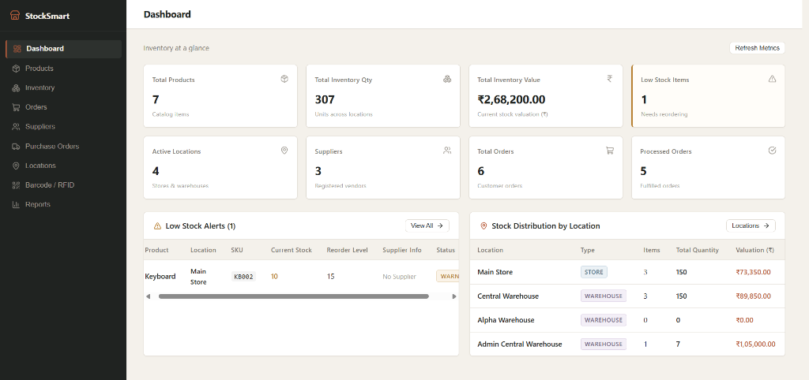
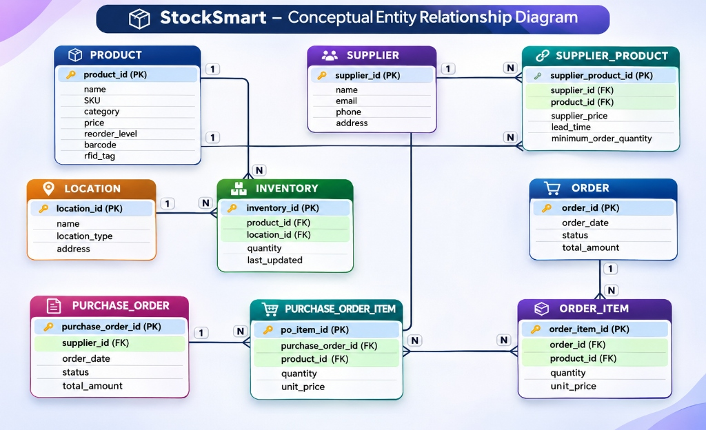
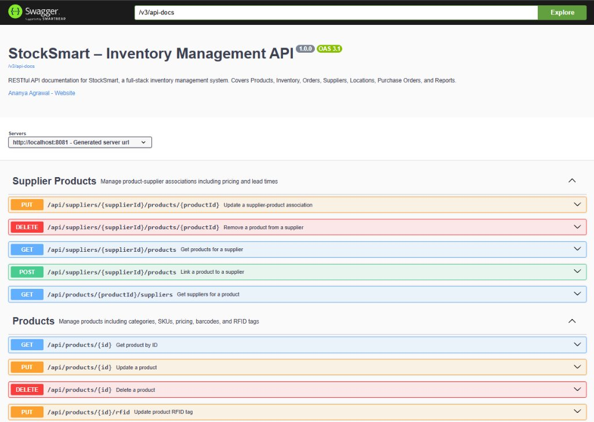

# 📦 StockSmart – Inventory Management System

A full-stack inventory management application built using **React.js**, **Spring Boot**, and **MySQL**, designed to streamline inventory operations across multiple stores and warehouses.

StockSmart provides a centralized platform to manage products, track stock, handle suppliers, process orders, and monitor inventory performance through insightful reports.

---

## ✨ Features

- **Dashboard & Analytics** – Monitor inventory statistics, stock valuation, orders, and low-stock alerts.
- **Product Management** – Manage products, categories, SKUs, pricing, and reorder levels.
- **Multi-Location Inventory** – Track and manage stock across stores and warehouses.
- **Supplier Management** – Maintain supplier details, product associations, pricing, and lead times.
- **Order Management** – Create and process customer orders with stock validation and automatic inventory updates.
- **Purchase Orders** – Manage supplier purchase orders and receive incoming stock.
- **Barcode & RFID** – Identify and search products using barcode and RFID identifiers.
- **Inventory Reports** – View inventory summaries, low-stock products, location-wise stock, and order statistics.

---

## 📸 Screenshots

### Dashboard



*The Dashboard provides an at-a-glance view of total products, inventory quantity and value, active locations, suppliers, orders, and low-stock alerts — along with a real-time stock distribution breakdown by location.*

---

## 🗄️ Database ER Diagram



*The ER diagram shows the relationships between the core entities: **Product**, **Inventory**, **Location**, **Supplier**, **Supplier\_Product**, **Order**, **Order\_Item**, **Purchase\_Order**, and **Purchase\_Order\_Item**.*

---

## 📡 API Documentation

StockSmart includes interactive API documentation powered by **Springdoc OpenAPI (Swagger UI)**.

Once the backend is running, open the following URL in your browser:

```
http://localhost:8081/swagger-ui/index.html
```

The documentation covers all REST endpoints organized by module — Products, Inventory, Orders, Suppliers, Locations, Purchase Orders, Supplier Products, and Reports — including request parameters, request bodies, and response codes.



*Swagger UI provides a live, interactive interface for exploring and testing all StockSmart backend APIs.*

---

## 🛠️ Tech Stack

| Category        | Technologies                                      |
|-----------------|---------------------------------------------------|
| Frontend        | React.js, JavaScript, HTML5, CSS3, Vite           |
| Backend         | Java, Spring Boot, Spring Web                     |
| Database        | MySQL                                             |
| ORM             | Spring Data JPA, Hibernate                        |
| API             | RESTful APIs                                      |
| API Docs        | Springdoc OpenAPI (Swagger UI)                    |
| Build & Testing | Maven, Postman                                    |
| Version Control | Git, GitHub                                       |

---

## 🏗️ Architecture

The application follows a layered architecture to maintain separation between the user interface, business logic, and database operations.

```
React.js Frontend (Port 5173)
         │
      REST APIs
         │
Spring Boot Backend (Port 8081)
         │
    ┌────┴────┐
Controllers  Services  Repositories
         │
  Spring Data JPA
         │
   MySQL Database
```

---

## 🚀 Getting Started

### Prerequisites

- Java JDK 17+
- MySQL 8.0+
- Node.js and npm
- Git

### 1. Clone the Repository

```bash
git clone https://github.com/ananya-ag286/StockSmart.git
cd StockSmart
```

### 2. Database Configuration

Create a MySQL database:

```sql
CREATE DATABASE hcl;
```

Update `src/main/resources/application.properties` with your database credentials:

```properties
spring.datasource.url=jdbc:mysql://localhost:3306/hcl
spring.datasource.username=root
spring.datasource.password=YOUR_MYSQL_PASSWORD
spring.jpa.hibernate.ddl-auto=update
server.port=8081
```

### 3. Start the Backend

From the project root:

```bash
# Windows
.\mvnw.cmd spring-boot:run

# Linux / macOS
./mvnw spring-boot:run
```

Backend runs at: **http://localhost:8081**

> Swagger UI available at: **http://localhost:8081/swagger-ui/index.html**

### 4. Start the Frontend

Open another terminal:

```bash
cd frontend
npm install
npm run dev
```

Frontend runs at: **http://localhost:5173**

Open **http://localhost:5173** in your browser to access StockSmart.

---

## 🔗 API Overview

The backend exposes RESTful APIs for all inventory operations.

**Base URL:** `http://localhost:8081/api`

| Module           | Endpoint                              | Operations                          |
|------------------|---------------------------------------|-------------------------------------|
| Products         | `/api/products`                       | Create, Read, Update, Delete        |
| Inventory        | `/api/inventory`                      | Stock management                    |
| Orders           | `/api/orders`                         | Create, Process, Cancel             |
| Suppliers        | `/api/suppliers`                      | Supplier management                 |
| Locations        | `/api/locations`                      | Multi-location management           |
| Purchase Orders  | `/api/purchase-orders`                | Procurement and stock receiving     |
| Supplier Products| `/api/suppliers/{id}/products`        | Supplier-product associations       |
| Reports          | `/api/reports`                        | Inventory analytics and summaries   |

> APIs can be tested using **Postman** or the built-in **Swagger UI** at `/swagger-ui/index.html`.

---

## 🔄 Order Processing

StockSmart validates inventory availability before processing customer orders.

1. Create a customer order.
2. Check product availability at the selected location.
3. Validate available stock quantities.
4. Process the order and automatically deduct inventory.
5. Update inventory reports.

> Order cancellation supports stock restoration where applicable.

---

## 🔮 Future Enhancements

- User authentication and role-based access control.
- Demand forecasting and inventory optimization.
- Automated low-stock notifications.
- Supplier performance analytics.
- Cloud deployment and monitoring.

---

## 👩‍💻 Author

**Ananya Agrawal**
[GitHub](https://github.com/ananya-ag286)

Developed as part of the **HCL Full Stack Development** project.
